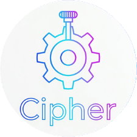

# 🧮 BATNA Cipher - Calculadora de Negociación

**BATNA Cipher** es una aplicación móvil desarrollada en Python con el framework **Kivy**, diseñada para realizar análisis de **ZOPA** (Zona de Posible Acuerdo) en procesos de negociación comercial y legal.

---

## 📸 Capturas de Pantalla

| Pantalla Principal | Aplicación Instalada |
| :---: | :---: |
|  |  |

*(Nota: Puedes subir las capturas del teléfono a una carpeta `docs/` o usarlas directamente en el README)*

---

## ✨ Características Principales

* **Análisis de ZOPA:** Cálculo de viabilidad, rangos de acuerdo y excedente en tiempo real.
* **Módulos Especializados:** Secciones para negociación de Litigio, Comercial, Historial y Autor.
* **Interfaz Adaptativa:** Diseño limpio y enfocado en usabilidad móvil.
* **Persistencia de Datos:** Historial interno mediante almacenamiento nativo en Android.

---

## 🛠️ Tecnologías y Herramientas

* **Lenguaje:** Python 3.10
* **Framework UI:** Kivy
* **Compilación Móvil:** Buildozer + python-for-android (p4a)
* **CI/CD Pipeline:** GitHub Actions (Compilación automatizada en la nube con Ubuntu 22.04 + Java 17 + NDK r25b)

---

## 🚀 Integración Continua (CI/CD)

El proyecto cuenta con un flujo automatizado en GitHub Actions que realiza la compilación cruzada a APK directamente en la nube, superando las restricciones de entorno local y generando artefactos listos para su distribución.

---

## 👤 Autor

**Ing. Norberto Hernández**  
* Cédula Profesional: 15061201  
* Arandas, Jalisco, México  
* **Marca/Firma:** Cipher  
